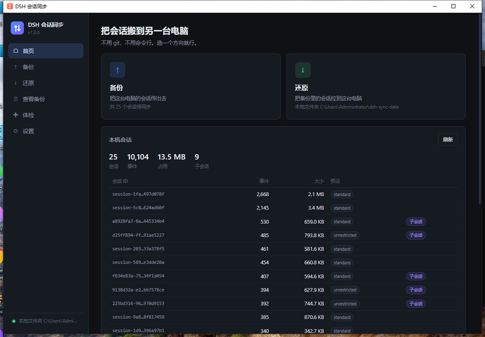
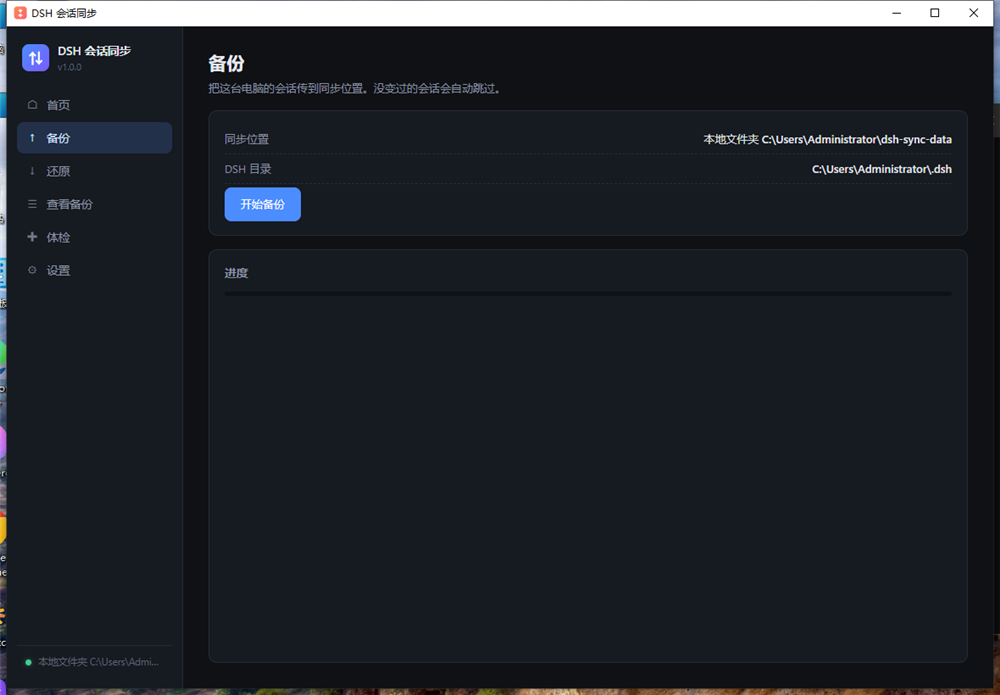
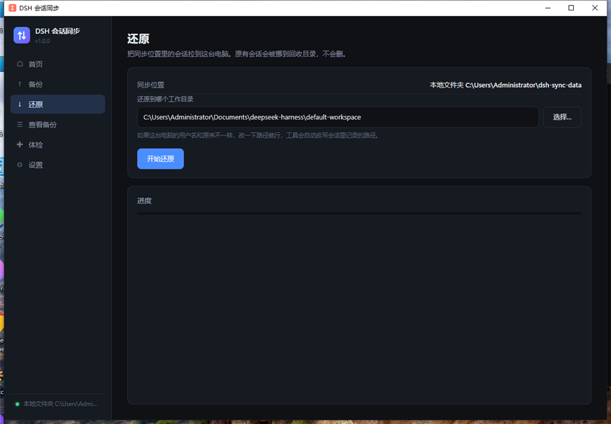
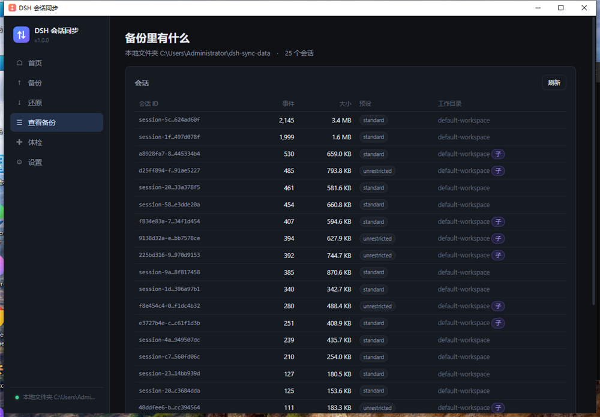
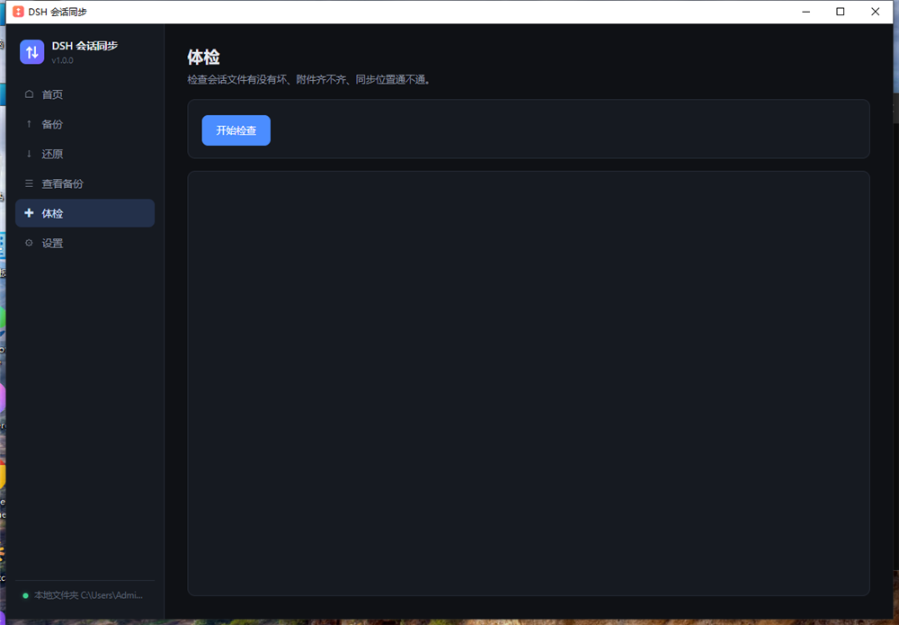

# DSH Sync

**Move your DeepSeek Harness chat sessions between computers. No git, no command line, no cloud account required.**

[]()
[]()
[]()

[中文说明](README.zh-CN.md)

---

## The problem

DeepSeek Harness (DSH) stores every conversation as a zstd-compressed append-only log under `~/.dsh/sessions/`. Those logs are **not portable by default**:

- The directory name is derived from the workspace path: `--C-Users-You-Documents-project--`
- The header frame inside the log stores the same absolute `cwd`
- On read, DSH recomputes the expected directory from the header and throws `corrupt session log` if they disagree

So copying `~/.dsh` to another machine with a different username silently breaks every session. This tool handles that.

## What it does

| Feature | Detail |
|---|---|
| **Storage-agnostic** | Local folder, USB drive, OneDrive/Nextcloud sync folder, WebDAV, or S3-compatible object storage |
| **Path rewriting** | Rewrites `header.cwd` and re-derives the project directory automatically |
| **Incremental** | SHA-256 per session; unchanged sessions are skipped |
| **Attachments** | Content-addressed (`sha256`), deduplicated, synced alongside sessions |
| **Parent-first restore** | Subagent sessions are written after their parents |
| **Cache reset** | Clears `session_projcache` and `workspace.json` so DSH rebuilds them for the new path |
| **Non-destructive** | Existing sessions are renamed to `.dsh-sync-trash-<timestamp>`, never deleted |
| **Zero dependencies** | Single-file CLI + Electron GUI, no external runtime needed |

## Screenshots

### Home — what's on this machine



### Backup — push sessions to the storage


### Restore — pull sessions, rewrite paths



### Browse — inspect the remote manifest



### Doctor — validate logs, attachments, connectivity



### Settings — pick a backend



## Quick start

### Option A — prebuilt package (Windows)

1. Download `DSH会话同步.zip` from [Releases](https://github.com/xiaofang-code/dsh-sync/releases)
2. **Right-click → Extract All** (do not run from inside the archive)
3. Double-click `启动.cmd`

> **Why not just the .exe?**
> This is an Electron app. `DSH_Sync.exe` is only the shell — it loads
> `resources/app.asar`, `locales/`, and ~70 DLL/PAK files from the same folder.
> Copying the exe alone makes it exit instantly with no window.
> Ship the whole folder, or the zip.

### Option B — from source

```bash
git clone https://github.com/xiaofang-code/dsh-sync.git
cd dsh-sync
npm install
npm start          # run the GUI in dev mode
```

Build a distributable:

```bash
node build/make-icon.mjs   # generate build/icon.ico
node build/pack.mjs        # → dist/DSH_Sync-win32-x64/
node build/pack-zip.mjs    # → dist/DSH会话同步.zip
```

### Option C — CLI only (no Electron)

```bash
node dsh-sync.mjs setup      # interactive first-run setup
node dsh-sync.mjs backup     # push
node dsh-sync.mjs restore    # pull
node dsh-sync.mjs list       # inspect remote manifest
node dsh-sync.mjs doctor     # validate
```

## Usage

### First run

The app opens on **Settings**. Pick a backend:

**Local folder** (simplest) — any directory. Put it on a USB drive, a network share, or inside your OneDrive/Nextcloud sync folder and the cloud client handles transport for you.

**WebDAV** — Nextcloud, 坚果云, Synology, etc.

**S3-compatible** — AWS S3, Alibaba OSS, Tencent COS, MinIO.

Set the **DSH data directory** (defaults to `%USERPROFILE%\.dsh`) and save.

### Machine A — backup

Sidebar → **Backup** → **Start backup**.

```
✓ session-5c0eb59e-...  3.4 MB
✓ 225bd316-...          744.7 KB
...
Done
✓ 25 sessions: 25 uploaded, 0 skipped
✓ 20.5 MB transferred
```

Second run skips everything unchanged.

### Machine B — restore

Point Settings at the same storage, then Sidebar → **Restore**.

- **Same username** → leave the workspace path as-is
- **Different username** → edit the path; the tool rewrites every session header

```
Done
✓ 25 sessions restored (25 had their workspace path rewritten)
· Restart DSH to see them.
```

### Restart DSH

Close and reopen DSH. The sessions appear in the sidebar and resume normally.

## How the path rewrite works

DSH's on-disk invariant:

```
sessions/<projectKey(header.cwd)>/<encodeSegment(header.id)>/session.v4.jsonl.zstd
```

`projectKey` maps `/ \ :` to `-`, keeps `[A-Za-z0-9._-]`, and escapes everything else as `~XXXX` (uppercase hex). On read, `assertStoredIdentity` recomputes this and compares.

The tool:

1. Splits the log into zstd frames by magic (`28 b5 2f fd`)
2. Decompresses **only frame 0** (the header), rewrites `cwd`, recompresses with the same options (`ZSTD_c_checksumFlag: 1`)
3. Concatenates the new header with the untouched event frames
4. Writes into the project directory derived from the new path

Event frames are pure append-only history and carry no path information, so they stay byte-identical. The result is indistinguishable from a natively written session — verified by opening every restored session through DSH's own `persistence.open(id, 'read')`.

## What is *not* synced

| Skipped | Why |
|---|---|
| `.credentials.yaml` | API keys stay local |
| `profiles/*/cordis.patch.yml` | Model/provider config is machine-specific |
| `cache/`, `dsh-runtimes/` | Rebuildable |
| `profiles/*/node_modules/` | Hundreds of MB, reinstall instead |

## Caveats

**Close DSH before backing up.** Sessions are append-only, so a live read usually works, but a closed DSH guarantees a clean snapshot.

**Presets must exist on both machines.** Sessions record their `agentPreset` (e.g. `standard`, `unrestricted`). Restoring a session whose preset is missing throws `agent-preset/not-found` when you open it. The tool prints the required presets at the end of every backup and restore.

**Restore replaces the session list.** Existing sessions are moved to `.dsh-sync-trash-<timestamp>` under `$DSH_HOME`, not deleted. Delete them manually once you're satisfied.

## Troubleshooting

Run **Doctor** first — it checks log readability, parent/child integrity, attachment presence, and storage connectivity.

| Symptom | Cause | Fix |
|---|---|---|
| Double-click does nothing | Only the exe was copied | Ship/extract the whole folder |
| Sessions missing after restore | Wrong workspace path | Restore again with the correct path |
| `agent-preset/not-found` | Preset not installed | Install the matching plugin |
| `corrupt session log` | Backed up while DSH was writing | Close DSH, back up again |
| Storage unreachable | Bad path / not logged in | Recheck Settings |
| "N attachments missing locally" | Cleaned on the source machine | Expected; shown as placeholders |

## Project layout

```
dsh-sync/
├── gui/
│   ├── main.cjs        Electron main process — window, config, IPC, jobs
│   ├── preload.cjs     Context-isolated bridge (whitelisted API only)
│   ├── index.html      UI structure
│   ├── style.css       Dark theme
│   ├── app.js          Renderer logic
│   └── core.mjs        Core library — scan, backup, restore, rewrite
├── build/
│   ├── make-icon.mjs   Generates icon.ico with no dependencies
│   ├── pack.mjs        electron-packager wrapper
│   ├── pack-zip.mjs    Delivery zip
│   └── shot.ps1        Screenshot automation
├── dsh-sync.mjs        Standalone CLI (same core logic)
├── docs/screenshots/   README images
└── dist/               Build output (gitignored)
```

`gui/core.mjs` is UI-agnostic — both the Electron app and the CLI import it.

## Requirements

- Windows 10/11 x64 (the path-rewrite logic is platform-agnostic; only the packaging is Windows-specific)
- Node.js 22+ for building from source
- DSH with session format v4

## License

MIT
